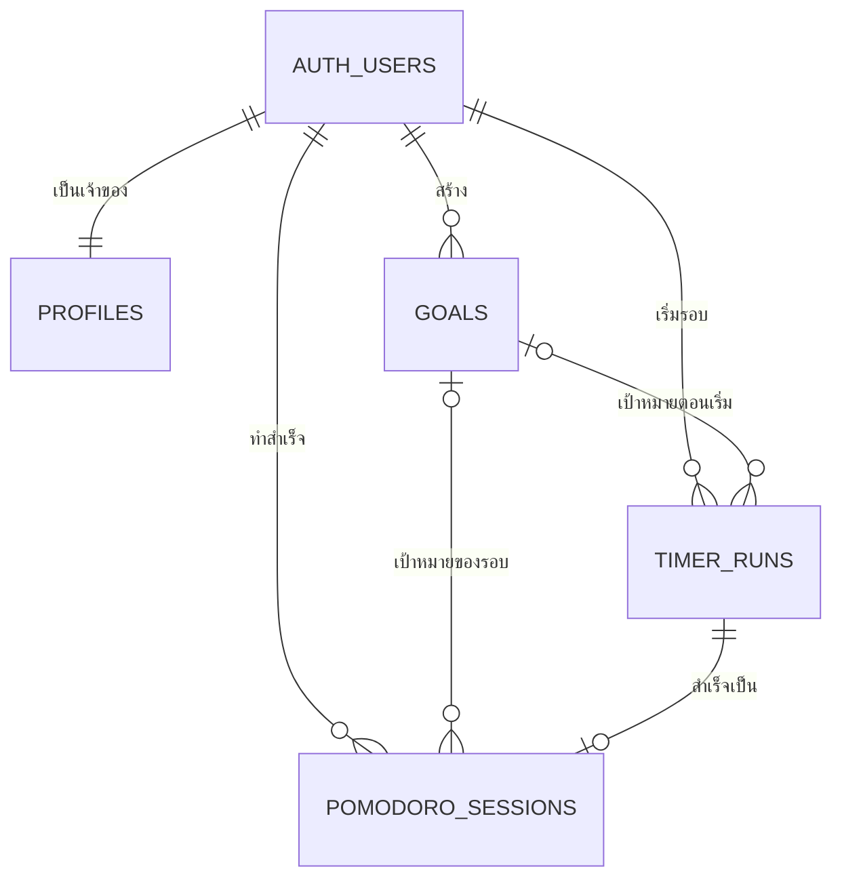

# โครงฐานข้อมูลที่วางแผนไว้ — Sti Pomodoro

> **สถานะ:** เอกสารนี้เป็นแบบร่างสำหรับ Supabase PostgreSQL ยังไม่ได้สร้างตารางหรือเชื่อมฐานข้อมูลจริงในแอป

เอกสารนี้ขยาย [แผนระบบสมาชิกและสถิติ](./MEMBERSHIP_STATS_PLAN.md) ให้เห็นว่าข้อมูลอะไรอยู่ตารางไหน และตารางเชื่อมกันอย่างไร

## 1. ภาพรวม

- `auth.users` เป็นตารางบัญชีที่ **Supabase Auth ดูแล** เราไม่เก็บรหัสผ่านเอง
- `profiles`, `goals`, `timer_runs` และ `pomodoro_sessions` เป็นตารางที่ **โปรเจกต์ต้องสร้าง**
- ผู้ที่ไม่สมัครสมาชิก (Guest) ใช้ตัวจับเวลาในเบราว์เซอร์ได้ แต่ **ไม่มีแถวข้อมูล** ในตารางเหล่านี้
- สถิติทั้งหมดอ่านจาก `pomodoro_sessions` ซึ่งเก็บเฉพาะ Work ที่ทำครบและบันทึกสำเร็จ

Supabase แนะนำให้แยกข้อมูลโปรไฟล์ที่แอปต้องอ่านไว้ในตาราง `public` และอ้างอิงรหัสผู้ใช้จาก `auth.users` โดยเปิด Row Level Security (RLS) ให้ตารางนั้น [เอกสาร Supabase: User Management](https://supabase.com/docs/guides/auth/managing-user-data)

## 2. ตารางข้อมูล

### 2.1 `auth.users` — บัญชีสมาชิก

Supabase Auth สร้างและจัดการให้ ใช้รหัส `id` เป็นตัวเชื่อมกับตารางของแอป อีเมลและรหัสผ่านอยู่ในระบบ Auth; แอปไม่สร้างคอลัมน์รหัสผ่านใน `profiles`

### 2.2 `profiles` — ข้อมูลที่แสดงของสมาชิก

| คอลัมน์ | ชนิดข้อมูลที่เสนอ | ใช้ทำอะไร |
| --- | --- | --- |
| `user_id` | `uuid` (PK, FK → `auth.users.id`) | เจ้าของโปรไฟล์; 1 บัญชีมี 1 โปรไฟล์ |
| `display_name` | `text` | ชื่อที่ผู้ใช้ตั้ง เช่น “มิน” |
| `timezone` | `text` | เขตเวลาที่ใช้สรุปวันนี้ เช่น `Asia/Bangkok` |
| `active_goal_id` | `uuid` (ว่างได้) | เป้าหมายที่เลือกอยู่; ต้องตรวจว่าเป็นของผู้ใช้คนนี้ |
| `created_at` | `timestamptz` | วันเวลาสร้าง |
| `updated_at` | `timestamptz` | วันเวลาแก้ไขล่าสุด |

ชื่อที่แสดงเป็นคนละข้อมูลกับชื่อเป้าหมาย และควรกำหนดความยาวสูงสุดก่อนทำฟอร์มจริง

### 2.3 `goals` — เป้าหมาย

| คอลัมน์ | ชนิดข้อมูลที่เสนอ | ใช้ทำอะไร |
| --- | --- | --- |
| `id` | `uuid` (PK) | รหัสเป้าหมาย |
| `user_id` | `uuid` (FK → `auth.users.id`) | เจ้าของเป้าหมาย |
| `title` | `text` | ชื่อเป้าหมาย เช่น “อ่านหนังสือสอบให้ผ่าน”; ต้องไม่ว่าง |
| `description` | `text` (ว่างได้) | รายละเอียดเพิ่มเติม |
| `target_sessions` | `integer` (ว่างได้) | จำนวนรอบ Work ที่ตั้งใจทำ; ถ้ามีต้องมากกว่า 0 |
| `target_date` | `date` (ว่างได้) | วันที่ตั้งใจทำให้ถึงเป้าหมาย |
| `status` | `text` | `active` หรือ `archived` |
| `created_at`, `updated_at` | `timestamptz` | วันเวลาสร้างและแก้ไข |

หนึ่งสมาชิกมีหลายเป้าหมายได้ แต่เลือกเป็น `active_goal_id` ได้ครั้งละหนึ่งรายการ การเก็บเป้าหมายเป็น `archived` ทำให้ประวัติเก่ายังอ้างถึงได้

### 2.4 `timer_runs` — สถานะรอบ Work ที่กำลังทำ

ตารางนี้ช่วยให้ฝั่งเซิร์ฟเวอร์รู้ว่ารอบนั้นเริ่ม พัก และกลับมาทำเมื่อไร ก่อนยอมรับว่า “ทำครบ” การพักสั้น พักยาว และ Stopwatch ไม่ต้องสร้างแถวในตารางนี้

| คอลัมน์ | ชนิดข้อมูลที่เสนอ | ใช้ทำอะไร |
| --- | --- | --- |
| `id` | `uuid` (PK) | รหัสรอบ Work |
| `user_id` | `uuid` (FK → `auth.users.id`) | เจ้าของรอบ |
| `goal_id` | `uuid` (FK → `goals.id`, ว่างได้) | เป้าหมายที่เลือกตอนเริ่ม |
| `goal_title_snapshot` | `text` (ว่างได้) | สำเนาชื่อเป้าหมายตอนเริ่ม เผื่อมีการเปลี่ยนชื่อภายหลัง |
| `planned_seconds` | `integer` | เวลา Work ที่ตั้งไว้ เช่น 1,500 วินาที; ต้องมากกว่า 0 |
| `active_seconds` | `integer` | เวลาที่ทำไปแล้วก่อนการพักครั้งล่าสุด |
| `status` | `text` | `running`, `paused`, `completed` หรือ `cancelled` |
| `started_at` | `timestamptz` | เวลาเริ่มรอบแบบ UTC |
| `last_resumed_at` | `timestamptz` (ว่างได้) | เวลาเริ่ม/กลับมาทำช่วงล่าสุด |
| `ended_at` | `timestamptz` (ว่างได้) | เวลาจบหรือยกเลิก |
| `completion_key` | `uuid` | รหัสที่ใช้ซ้ำเมื่อส่งคำขอบันทึกเดิมอีกครั้ง |

ค่าของ `active_seconds` และสถานะรอบต้องเปลี่ยนผ่านฟังก์ชันฝั่งเซิร์ฟเวอร์ ไม่ให้เบราว์เซอร์แก้เป็น “ครบแล้ว” ด้วยตัวเอง

### 2.5 `pomodoro_sessions` — ประวัติ Work ที่ทำครบ

| คอลัมน์ | ชนิดข้อมูลที่เสนอ | ใช้ทำอะไร |
| --- | --- | --- |
| `id` | `uuid` (PK) | รหัสรายการประวัติ |
| `run_id` | `uuid` (FK → `timer_runs.id`, UNIQUE) | หนึ่งรอบ Work บันทึกสำเร็จได้ครั้งเดียว |
| `user_id` | `uuid` (FK → `auth.users.id`) | เจ้าของสถิติ |
| `goal_id` | `uuid` (FK → `goals.id`, ว่างได้) | เป้าหมายของรอบ |
| `goal_title_snapshot` | `text` (ว่างได้) | ชื่อเป้าหมายตอนเริ่มรอบ |
| `planned_seconds` | `integer` | เวลา Work ที่ตั้งไว้ |
| `focused_seconds` | `integer` | เวลาที่ทำครบจริง; ไม่นับช่วง Pause |
| `started_at`, `completed_at` | `timestamptz` | เวลาเริ่มและจบแบบ UTC |
| `completed_local_date` | `date` | วันที่ตามเขตเวลาของผู้ใช้ ณ ตอนจบ เช่น `2026-10-27` |
| `timezone_at_completion` | `text` | เขตเวลาที่ใช้คำนวณวันนั้น |
| `completion_key` | `uuid` | ใช้กันคำขอบันทึกซ้ำ; UNIQUE ร่วมกับ `user_id` |

เมื่อรอบ Work จบ ฟังก์ชันฝั่งเซิร์ฟเวอร์ตรวจสถานะ `timer_runs` แล้วเปลี่ยนเป็น `completed` และเพิ่มรายการ `pomodoro_sessions` ในขั้นตอนเดียวกัน ถ้าส่งคำขอเดิมซ้ำ ให้คืนผลรายการเดิมโดยไม่เพิ่มสถิติอีก

## 3. วิธีคำนวณสถิติ

| สิ่งที่แสดง | วิธีคิดจาก `pomodoro_sessions` |
| --- | --- |
| วันนี้ทำกี่รอบ | นับแถวของผู้ใช้ที่ `completed_local_date` เป็นวันนี้ตามเขตเวลาเขา |
| วันนี้โฟกัสกี่นาที | รวม `focused_seconds` ของวันนี้ แล้วแปลงเป็นนาที |
| วันที่เคยทำ | จัดกลุ่มตาม `completed_local_date` |
| เดือนที่เคยทำ | จัดกลุ่มเดือน `YYYY-MM` จาก `completed_local_date` |
| ตามเป้าหมาย | กรองตาม `goal_id` แล้วนับรอบ/รวมเวลา |
| ไม่มีเป้าหมาย | แสดงรายการที่ `goal_id` ว่าง |

ตัวอย่าง: ผู้ใช้ใน `Asia/Bangkok` ทำ Work 25 นาทีครบวันที่ 27 ตุลาคม เวลา 23:55 → ได้ 1 รอบ, `focused_seconds = 1500`, `completed_local_date = 2026-10-27` และถูกนับในเดือน `2026-10`

## 4. สิทธิ์และกติกาสำคัญ

- เปิด RLS และกำหนดสิทธิ์แยกสำหรับ `profiles`, `goals`, `timer_runs`, `pomodoro_sessions` โดยผูกเจ้าของกับ `auth.uid()` [เอกสาร Supabase: RLS](https://supabase.com/docs/guides/database/postgres/row-level-security)
- สมาชิกอ่าน/แก้ข้อมูลโปรไฟล์และเป้าหมายของตนได้ แต่ไม่เห็นข้อมูลของบัญชีอื่น
- เมื่อเลือกเป้าหมายหรือเริ่มรอบ Work ต้องตรวจว่า `active_goal_id` และ `goal_id` เป็นเป้าหมายของสมาชิกคนนั้นจริง
- การเริ่ม พัก ต่อ ยกเลิก และจบรอบ Work ต้องผ่านฟังก์ชันที่ตรวจสมาชิกและเวลาที่ทำจริง; การสร้าง/แก้ `timer_runs` และ `pomodoro_sessions` โดยตรงจากเบราว์เซอร์ควรถูกปิด
- Guest อ่านหรือเขียนตารางเหล่านี้ไม่ได้ และไม่มีประวัติให้ดึงกลับหลังสมัคร
- คีย์ลับที่ข้าม RLS อยู่เฉพาะฝั่งเซิร์ฟเวอร์ ห้ามใส่ในโค้ด React; ฟังก์ชันที่ผู้ใช้เรียกต้องตรวจ JWT ของผู้ใช้ [เอกสาร Supabase: Securing Edge Functions](https://supabase.com/docs/guides/functions/auth)
- เพิ่มดัชนี `(user_id, completed_local_date)` และ `(user_id, goal_id)` ในตารางประวัติเพื่อรองรับหน้าสถิติ

## 5. ลำดับสร้างฐานข้อมูลจริง

1. สร้างโปรเจกต์ Supabase และตั้ง Auth
2. สร้าง `profiles` กับ `goals` พร้อมข้อบังคับข้อมูลและ RLS
3. สร้าง `timer_runs` กับ `pomodoro_sessions` พร้อมคีย์กันข้อมูลซ้ำและดัชนี
4. ทำฟังก์ชันฝั่งเซิร์ฟเวอร์สำหรับเริ่ม/พัก/ต่อ/จบรอบ Work
5. ทดสอบด้วยบัญชี 2 คนว่าอ่านข้อมูลข้ามบัญชีไม่ได้ และ Guest ใช้ timer ได้แต่ไม่สร้างข้อมูล
6. เชื่อม React กับ Auth, เป้าหมาย และสถิติ

**หมายเหตุ:** รายละเอียดในไฟล์นี้เป็นโครงสำหรับรีวิวก่อนเขียน SQL migration จริง ค่าเริ่มต้น ข้อบังคับ และนโยบาย RLS จะถูกระบุเป็นคำสั่ง SQL ในขั้นลงมือทำ
